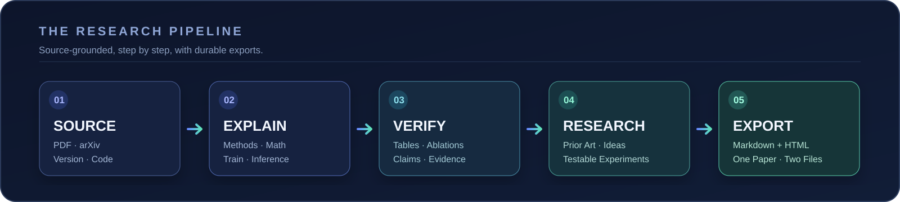

<div align="center">


<br />

**A research-grade paper reading skill for ChatGPT.**  
**一个面向科研实践的 AI 论文深度精读 Skill。**

[](SKILL.md)
[](#readme-languages)
[](#automatic-note-export)
[](#what-it-does)

<a id="readme-languages"></a>
**[English](#english) · [简体中文](#简体中文)**

</div>

---

<a id="english"></a>

## ✨ English

> **Don't just summarize a paper. Understand its assumptions, derive its equations, trace its implementation, and test its claims.**

**AI Paper Deep Dive** is a reusable [ChatGPT Skill](SKILL.md) for graduate-level, evidence-grounded analysis of AI research papers. It turns a paper PDF, arXiv link, title, or GitHub repository into an explainable research journey—from the motivation and mathematical details to the training/inference pipeline, reproducibility concerns, and testable research ideas.

It is designed especially for **LLMs, MLLMs/VLMs, diffusion models, agents, reinforcement learning, efficient inference, world models, and embodied AI**.

### Why AI Paper Deep Dive?

Most paper summaries answer *“What did the authors do?”* This skill is designed to go further:

| Typical summary | AI Paper Deep Dive |
|---|---|
| Rephrases the abstract | Reconstructs the **problem, assumptions, and reasoning** |
| Mentions architecture components | Tracks **data flow, tensor shapes, masks, and trainable parameters** |
| Lists equations | Explains **symbols, derivations, intuitions, and gradients** |
| Repeats performance gains | Audits **baselines, ablations, fairness, and unsupported claims** |
| Links a repository | Maps **paper modules to code** when the code is accessible |
| Suggests broad future work | Designs **falsifiable hypotheses and minimal experiments** |
| Leaves notes inside a chat | **Exports Markdown + HTML** research notes automatically |

### What it does

<table>
<tr><td width="50%" valign="top">

#### 🧠 01 · Teach from first principles
- Identify prerequisite concepts and foundational papers
- Break down the motivation and method step by step
- Explain math with symbol definitions and tensor dimensions
- Distinguish the paper's derivation from teaching supplements

#### 🧩 02 · Trace the entire system
- Inspect architecture and modality fusion
- Separate training, inference, and evaluation paths
- Track losses, gradient flow, freezing, and attention masks
- Explain algorithmic choices and practical trade-offs

#### 🔬 03 · Audit the evidence
- Check what each experiment actually supports
- Examine baseline fairness and ablations
- Mark missing implementation details
- Separate **paper evidence / code evidence / interpretation**

</td><td width="50%" valign="top">

#### 💻 04 · Read paper and code together
- Map methods to files, classes, and functions
- Verify implementation details when source is available
- Build minimal reproduction or smoke-test plans
- Flag discrepancies and unverified assumptions

#### 💡 05 · Turn understanding into research
- Search prior work before judging novelty
- Identify limitations, counterexamples, and research gaps
- Formulate hypotheses and discriminating experiments
- Consider low-compute and training-free alternatives

#### 🗂️ 06 · Keep durable research notes
- Auto-generate **one `.md` and one `.html` per paper**
- Preserve equations, tables, code, sources, and open questions
- Support **in-progress** notes for chapter-by-chapter reading
- Use a navigable HTML reader with a responsive layout

</td></tr>
</table>

### How it works



1. **Identify the exact paper** — title, authors, version, official code, and available appendices.
2. **Ground claims in the source** — inspect sections, figures, equations, tables, and relevant implementations.
3. **Explain the method** — architecture, symbolic math, tensor shapes, training, and inference.
4. **Audit experimental support** — what was measured, what is missing, and what remains uncertain.
5. **Investigate new ideas when requested** — compare related research and design falsifiable tests.
6. **Export notes automatically** — deliver downloadable Markdown and HTML files without an extra prompt.

### Start using it

#### Option A · Install as a custom ChatGPT Skill

1. Download or clone this repository.
2. Keep `SKILL.md`, `agents/`, `references/`, and `scripts/` together.
3. Package the skill folder into a `.zip` archive if needed.
4. In a ChatGPT environment that supports custom Skills, open the Skills library and upload the archive.
5. Upload a paper or paste an arXiv link, then ask it to read the paper.

> Availability of custom Skill installation and file-generation tools depends on the ChatGPT environment. The skill describes a workflow; some steps require access to the full paper, the web, code repositories, or local file-writing tools.

#### Option B · Inspect or adapt the workflow

Read [`SKILL.md`](SKILL.md) directly, customize the guides in [`references/`](references/), or use the HTML renderer independently.

### Example prompts

**Deep reading**

```text
Read Visual Instruction Tuning (LLaVA) in depth.
Explain its architecture, feature alignment stage, visual instruction tuning,
loss masking, tensor shapes, and end-to-end inference pipeline.
Show the evidence for each important claim.
```

**Interactive, chapter-by-chapter teaching**

```text
Guide me through this paper like a graduate research mentor.
Start with the motivation and prerequisites, then teach one section at a time.
Explain each important equation and give me two comprehension questions.
```

**Paper ↔ code review**

```text
Compare this paper with its official GitHub repository.
Trace the forward pass, training loss, trainable parameters, and inference entry points.
Mark every mechanism that cannot be verified.
```

**Research idea audit**

```text
Critically review this idea against relevant prior work.
Identify the closest methods, strongest counterexamples, novelty risks,
and the smallest useful experiment I could run.
```

### Automatic note export

The skill is configured to generate **two downloadable outputs per paper** during full-paper or ongoing chapter-by-chapter reading:

```text
2304.08485_llava_visual_instruction_tuning_notes.md
2304.08485_llava_visual_instruction_tuning_notes.html
```

The Markdown note may contain a research overview, prerequisite map, methods, mathematics, tensor shapes, training and inference pipelines, experiments, reproducibility checklist, research ideas, references, and unresolved questions. Partial readings are marked **In Progress** rather than presented as complete.

The HTML reader is generated from the Markdown note, with a table of contents, mobile-friendly layout, code blocks, tables, print styles, and dark-mode-aware styling. **MathJax is loaded from a CDN:** text remains available offline, but rendered mathematics may require an internet connection.

<details>
<summary><strong>Render Markdown → HTML locally</strong></summary>

Requires Python 3 and [`mistune`](https://github.com/lepture/mistune) version 3 or newer.

```bash
python -m pip install "mistune>=3"
python scripts/render_paper_html.py your_paper_notes.md --output your_paper_notes.html
```

The exporter is provided in [`scripts/render_paper_html.py`](scripts/render_paper_html.py).

</details>

### Evidence before confidence

This skill follows three explicit levels of epistemic confidence:

| Level | Meaning | Example |
|:---:|---|---|
| **A** | Directly supported by the paper | Section 3.2, Equation 4, Figure 2 |
| **B** | Supported by accessible code or independent material | Verified function and source revision |
| **C** | Reasoned interpretation or hypothesis | A proposed explanation to test |

It **does not** treat an unsearched idea as novel, fabricate pages or results, or pretend inaccessible code has been verified. Research-gap assessments are limited by the literature and tools actually available.

### Repository guide

```text
ai-paper-deep-dive/
├── SKILL.md                         # Core reading & research workflow
├── agents/
│   └── openai.yaml                  # Skill display metadata
├── references/
│   ├── teaching-protocol.md         # Math, shapes, teaching checks
│   ├── evidence-and-experiments.md  # Experiment & evidence audits
│   ├── research-audit.md            # Novelty & hypothesis reviews
│   ├── output-modes.md              # Output structures
│   └── archiving-and-export.md      # Markdown / HTML note rules
├── scripts/
│   └── render_paper_html.py         # Markdown-to-HTML exporter
└── assets/
    ├── hero.svg                     # README artwork
    └── workflow.svg                 # Research pipeline diagram
```

---

<a id="简体中文"></a>

## 🇨🇳 简体中文

> **不止是“总结论文”，更要理解设计动机、推导关键公式、追踪训练与推理、核查实验结论，并将论文转化为可验证的科研问题。**

**AI Paper Deep Dive** 是一个用于 AI 科研论文精读的 [ChatGPT Skill](SKILL.md)。它面向有深度学习基础、希望进一步掌握论文方法与科研思维的读者，支持上传论文 PDF、提供 arXiv 链接、论文标题或 GitHub 仓库。

它将论文阅读整理成一条完整路径：

**研究背景 → 前置知识 → 架构与数学推导 → 训练与推理 → 实验审查 → 代码对照 → Research Idea → 自动归档**

主要覆盖 **LLM、大语言模型后训练、多模态大模型（MLLM/VLM）、Diffusion、Agent、RL、高效推理、世界模型与具身智能** 等方向。

### 🌟 核心能力

| 功能 | 具体内容 |
|---|---|
| 🧠 **研究生式教学** | 从研究背景和前置知识开始，按章节解释方法及设计取舍 |
| 📐 **详细数学推导** | 逐符号解释公式、Tensor Shape、Loss、梯度传播和优化目标 |
| 🧩 **模型架构拆解** | 说明模块输入输出、视觉/文本 Token、Attention、Mask 和训练参数 |
| 🔄 **训练与推理还原** | 讲清数据预处理、训练阶段、参数冻结、Teacher Forcing、Prefill/Decode 等适用环节 |
| 🧪 **实验与消融审查** | 核查数据集、指标、Baseline、公平性、负面结果及结论支持范围 |
| 💻 **论文与源码对照** | 有代码访问权限时定位文件、函数、Forward、Loss 与推理实现 |
| 🔍 **相关工作与 Idea 审核** | 查找相似研究、分析创新性风险，设计有反例和中止标准的验证实验 |
| 📝 **自动生成科研笔记** | 每篇论文默认生成独立 Markdown + HTML，不必再次提醒 |

### 🗺️ 一张图理解工作流程


与只解释 Abstract 的工具不同，本 Skill 强调：

- **讲清为什么**：为什么这样设计？有没有更简单的替代？设计成立需要什么假设？
- **讲清怎么做**：各模块的 Input/Output、Shape、Loss 和梯度路径是什么？
- **讲清证据**：结论来自原文表格、实际代码，还是额外的合理推断？
- **讲清能否复现**：有哪些没有报告的训练参数？最小验证实验怎么设计？
- **讲清下一步**：哪些局限值得研究？哪些 Idea 已有相似工作？如何设计可证伪实验？

### 🚀 安装方法

**在支持自定义 Skills 的 ChatGPT 环境中：**

1. 下载或克隆本仓库。
2. 保持 `SKILL.md`、`agents/`、`references/`、`scripts/` 在同一个 Skill 目录中。
3. 按平台要求将 Skill 目录打包为 ZIP，并上传到 Skills 库。
4. 直接上传论文 PDF 或粘贴 arXiv 链接，即可开始使用。

> 具体的 Skill 安装入口与文件生成能力取决于当前 ChatGPT 环境。代码审查、最新文献检索和实际文件导出也需要相应工具权限，无法访问的内容应明确注明。

### 💬 使用示例

**示例一：完整精读 LLaVA**

```text
精读 LLaVA（Visual Instruction Tuning）。
请从研究动机开始，详细介绍模型结构、视觉特征对齐、
指令微调、Loss Mask、Tensor Shape、梯度更新及完整推理流程。
结合原文图表与公式解释，并区分原文结论和额外推断。
```

**示例二：交互式逐章精读**

```text
像研究生导师一样带我读这篇论文。
先讲前置知识与研究背景，再逐章讲方法和公式。
每章给出直觉例子、必要的推导与理解检查题。
```

**示例三：论文与代码核查**

```text
对照官方 GitHub 源码精读这篇论文。
重点追踪 Forward、Backward、Loss、数据预处理、
参数冻结以及训练和推理的差异。
```

**示例四：Research Idea 审核**

```text
请从审稿人的角度分析这篇论文的不足。
检索相关与后续工作，检查潜在 Idea 是否已被研究，
给出最强反例、创新性风险和小算力验证方案。
```

### 📚 自动导出 Markdown / HTML

当你要求精读整篇论文，或者采用连续章节式精读时，Skill 会将**自动双格式导出**作为默认交付步骤，不需要额外说“帮我生成文档”。

| 格式 | 适合用途 | 内容特点 |
|---|---|---|
| **Markdown `.md`** | Obsidian、Typora、VS Code、GitHub | 公式、代码、引用、方法与科研笔记，便于版本管理 |
| **HTML `.html`** | 浏览器、分享、打印 | 目录导航、响应式排版、代码和表格、明暗模式 |

对于尚未读完的论文，生成的文档会标明 **“进行中”**，并列出已覆盖和尚未覆盖的章节，不会把未核查内容写成已完成的结论。

如果需要在本地把 Markdown 转换成 HTML：

```bash
python -m pip install "mistune>=3"
python scripts/render_paper_html.py your_paper_notes.md --output your_paper_notes.html
```

HTML 的正文可以离线阅读；数学公式默认通过 MathJax CDN 排版，离线时可能显示 LaTeX 源码。

### 🛡️ 可验证性与边界

严格区分三个证据等级：

- **A · 原文证据**：论文 Section、Page、Figure、Table、Equation 等可以直接定位。
- **B · 代码或旁证**：可访问的官方源码、提交版本或其他可信材料。
- **C · 分析性推断**：模型作出的解释、待验证假设或可能的 Research Idea。

对于论文没有报告的实现细节，应标注 **“未报告 / 未核实”**；对于尚未完成检索的 Idea，不应断言“没有人做过”。

### 🤝 Contributing / 参与贡献

欢迎通过 [Issues](https://github.com/Tazewell/ai-paper-deep-dive/issues) 提交问题、论文类型支持建议、导出样式优化或复现审查改进；也欢迎通过 Pull Request 完善 Skill 指令、示例和文档。

If this workflow helps your research, consider starring the repository ⭐

---

<div align="center">

**Read deeply. Reason precisely. Research confidently.**  
**读懂论文 · 严谨求证 · 走向科研**

[⬆ Back to top](#readme-languages) · [Skill instructions](SKILL.md) · [Report an issue](https://github.com/Tazewell/ai-paper-deep-dive/issues)

</div>
